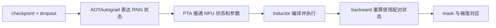

# NPU Inductor 可重放 RNG：设计串讲与测试说明

日期：2026-10-26。对象：测试同事。
依据：[PR #47685](https://gitcode.com/Ascend/pytorch/pull/47685)，本轮已核对提交 `994df68554a27005f3ed924078d83854def8d630`。本文更新验收范围，没有新增实测结果。

## 1. 本次验收范围

按本次明确的边界，只验收 **NPU Inductor 编译训练中的 RNG 状态传递与重放**，重点使用 `triton_experimental` 后端。

这里的“图”指 torch.compile / AOTAutograd / Inductor 的编译图，**不包含 NPUGraph/ACLGraph 的设备任务 capture/replay**，不要求测试设备图注册、stream capture 或设备图 replay。

本次不展开 AMP 全矩阵、二阶求导、长时间内存、并发压力、大模型和性能专项。它们不作为本功能的验收门槛。

## 2. 一分钟讲清为什么需要

dropout 会随机把一部分元素置零，mask 就是记录哪些元素保留的 0/1 张量。

checkpoint 为节省内存，会在 backward 时重新计算部分前向。这次重算必须找回原前向的随机状态，产生对应的 dropout mask，否则梯度就不再对应原来的前向结果。

例如丢弃概率 p=0.5，输入 x=[1,2,3,4]，mask=[1,0,1,0]：

```text
前向输出 y = x * mask / (1-p) = [2,0,6,0]
loss = sum(y)
输入梯度 = mask / (1-p) = [2,0,2,0]
```

**功能目标不是每一步训练都产生同一个 mask，而是恢复同一状态后能够复现，并保证原前向和它的重算配对。**

## 3. 三分钟讲设计

seed 可以理解为选定随机序列，offset 表示消费位置；generator state 用于保存和恢复相关状态。

当前 PR 主要接通四处：

| 落点 | 作用 |
|---|---|
| `torch_npu/utils/_inductor.py` | 注册 NPU graphsafe RNG 能力，接入 NPU seed/offset，处理 functionalized RNG 参数顺序和设备检查 |
| `torch_npu/utils/_dynamo.py::_lazy_inductor_setup` | 在进入 Inductor 时安装相关适配 |
| `torch_npu/_inductor/_npu_meta_registration.py::_npu_fix_generator_state_fallback` | 让 Inductor 能处理 NPU GeneratorState 参数，跨过上游 CUDA-only 假设 |
| `test/_inductor/triton_experimental/test_graphsafe_rng_replay.py` | 验证基础状态行为及编译训练场景 |



`graphsafe_run_with_rng_state` 是此链路里的状态执行包装名称；出现这个名字不表示启用了 ACLGraph。这里也不要求随机算子必须生成原生 Triton RNG kernel，允许保留必要的算子级 fallback，但不能退回 eager 绕过待测编译链路。

## 4. 测试只围绕四项展开

| 测试 | 怎么测 | 通过标准 |
|---|---|---|
| 1. RNG 状态使用与恢复 | 指定一份 NPU RNG state 执行随机算子，对照预期序列；执行后再生成外部随机数 | 指定状态产生预期结果，外部随机序列未被扰乱 |
| 2. seed/offset 接入 | 检查 helper 的 NPU 接入和 offset 计算；补充设置/读取、保存/恢复同一 seed/offset 的行为断言 | 状态读写对应 NPU；恢复相同 seed/offset 后，下一段随机输出精确一致 |
| 3. Inductor 随机序列重放 | 开启 functionalized RNG，编译包含两个随机算子的函数；相同初始状态重跑，并用不同状态作对照 | 同初始状态、同执行序列的输出逐元素一致；序列未被固定死 |
| 4. checkpoint + dropout 编译训练 | `use_reentrant=False, preserve_rng_state=True`；前向后计算 `out.sum().backward()`，比较 mask 和梯度；相同状态重复运行 | 前向 mask 与梯度对应；同初始状态下 output/grad 可重现；正常编译和反传 |

现有 PR 文件已经有这四个测试。**第 2 项目前主要检查 patch 标记、设备放行和 offset helper 返回值；建议在原用例中补充状态读写/恢复断言，不另起庞大矩阵。** 其余沿用已有用例即可，两个既有 shape 足以作为本轮基础覆盖。

第 1 项中，传入的 state 会正常向前消费：连续两次调用应对应参考序列的第一段、第二段，不要求同一个可变 state 对象每次返回相同输出。

## 5. checkpoint/dropout 最重要的断言

使用非零输入、`training=True`、`0 < p < 1`，令 loss 为输出求和：

```text
前向 mask = output 是否非零
梯度 mask = input.grad 是否非零

要求：
前向 mask == 梯度 mask
input.grad 与 mask / (1-p) 数值对齐
恢复相同初始状态重跑，output 和 grad 一致
```

mask 用逐元素精确比较；简单 FP32 图的缩放关系用明确的浮点容差。不要只检查“程序能跑完”或只比较 loss。

不要求 NPU 和 GPU 在相同 seed 下产生同样 mask，也不把不同随机实现之间的 mask 差异直接判为重放失败。

## 6. 怎么运行和记录

先确认实际 Python 加载了包含目标提交的 PTA 包，避免源码已更新、运行时仍加载旧包：

```bash
python -c "import torch, torch_npu; print(torch.__version__, torch_npu.__version__); print(torch.__file__); print(torch_npu.__file__); print(torch.npu.is_available())"
```

进入 PTA 仓根目录执行：

```bash
python -m pytest -v -ra test/_inductor/triton_experimental/test_graphsafe_rng_replay.py
```

记录软件版本、设备型号、候选提交、包加载路径和四项结果。必须是真实执行的 PASS；无 NPU、算子不支持、skip 都不能算通过。

现有 checkpoint 用例未设置 `fullgraph=True`，因此它的 PASS 不直接证明零 graph break；本次验收不要求另外量化 graph break，但应确认执行到目标 Inductor 随机状态路径，而非通过 eager 绕过问题。

## 7. 最终验收结论怎么写

> 在指定 PyTorch/PTA 版本及 NPU 设备上，使用 triton_experimental 后端，验证了 NPU RNG 状态接入、Inductor 随机序列重放，以及 checkpoint + dropout 的前向/反向随机状态一致性。四项测试通过，满足本轮 Inductor RNG 重放功能范围；不涉及 ACLGraph。

这是预期结论模板，必须在四项实际通过、包括第 2 项增强断言通过后填写，不能把本文当作新增 PASS 记录。

串讲收尾一句话：**能找回同一段随机数，重算的 mask 对得上，后面的随机序列不被打乱。**
