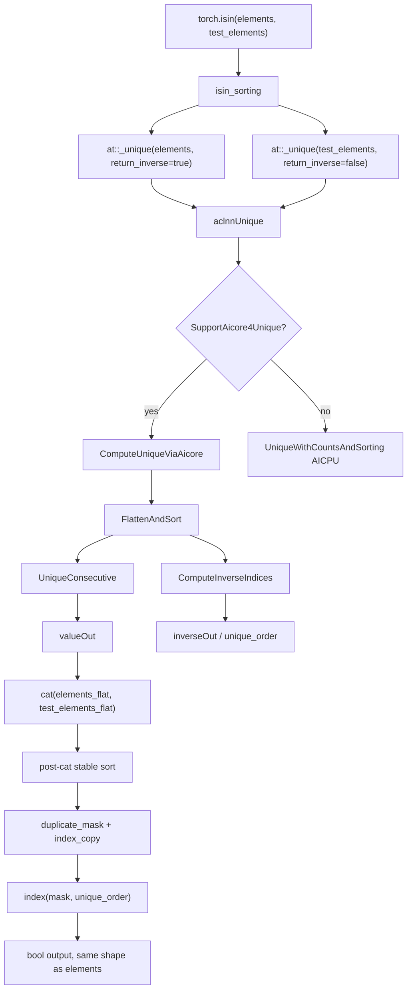

# torch.isin BF16 signed zero 精度问题整体分析

## 1. 结论摘要

这次 `torch.isin` 的 BF16 精度问题，核心疑点不在普通排序本身，而在 `assume_unique=False` 时 `torch.isin` 会先调用 `_unique`。在 Ascend NPU 的 `aclnnUnique` AICore 路径里，`unique` 内部还会执行一次 `FlattenAndSort`，然后再走 `UniqueConsecutive` 去重，并单独计算 `inverseOut`，也就是 `unique_order`。

目前最可疑的链路是：

```text
BF16 中 +0.0 和 -0.0 数值相等，但 bit pattern 不同
    ↓
UniqueConsecutive 去重时把它们当成同一个值
    ↓
AICore 当前实现保留等值 run 的最右侧元素，而 CPU/CUDA 语义更接近保留最左侧元素
    ↓
如果 inverse 生成逻辑和 valueOut 去重逻辑对 +0/-0 的判等不一致
    ↓
valueOut 只有 1 个 0，但 unique_order 可能从期望的 [0, 0] 变成 [0, 1]
    ↓
torch.isin 最后用 unique_order 去索引 mask，索引 1 可能读到 test_elements 半边的 mask
    ↓
invert=True 时尤其容易表现为 false/true 被反过来
```

一句话版：`torch.isin` 最后输出的是 bool mask。它先把 `elements` 去重，再把去重后的 `elements` 和 `test_elements` 拼起来排序做相邻比较。`+0.0/-0.0` 会触发问题，是因为它们“数值相等但底层 bit 不同”，去重和 inverse 映射一旦不一致，最后还原到原始 `elements` 位置时就会拿错 mask。

## 2. 源码证据索引

本次结论主要基于下面几处源码和本地复现脚本。`op-plugin` 路径来自前面已经追过的 PTA 源码记录；当前 workspace 里完整可查的是 `ops-nn` 侧源码。

| 结论 | 源码位置 | 关键函数 |
| --- | --- | --- |
| `isin` 大规模输入走 sorting 算法 | `op_plugin/ops/opapi/IsInKernelNpuOpApi.cpp` | `isin_sorting` |
| `assume_unique=False` 时，`elements` 会调用 `_unique(... return_inverse=true)` | `op_plugin/ops/opapi/IsInKernelNpuOpApi.cpp` | `isin_sorting` |
| NPU `_unique` 优先调 `aclnnUnique` | `op_plugin/ops/opapi/_UniqueKernelNpuOpApi.cpp` | `op_api::_unique` |
| AICPU fallback 名称是 `UniqueWithCountsAndSorting` | `work/ops-nn/index/unique_with_counts_and_sorting/op_host/op_api/unique_with_counts_and_sorting.cpp` | `UniqueWithCountsAndSorting` |
| `aclnnUnique` 支持时走 AICore | `work/ops-nn/index/unique_consecutive/op_api/aclnn_unique.cpp` | `ComputeUniqueViaAicore`, `SupportAicore4Unique` |
| `aclnnUnique` AICore 内部先排序 | `work/ops-nn/index/unique_consecutive/op_api/unique_common.cpp` | `FlattenAndSort` |
| 内部排序调用 stable sort | `work/ops-nn/index/unique_consecutive/op_api/unique_common.cpp:96` | `l0op::Sort(selfFlatten, 0, false, true, ...)` |
| inverse 单独计算，不来自 `UniqueConsecutive` 返回值 | `work/ops-nn/index/unique_consecutive/op_api/unique_common.cpp:104` | `ComputeInverseIndices` |
| inverse 由相邻差分、前缀和、scatter 生成 | `work/ops-nn/index/unique_consecutive/op_api/unique_common.cpp:111` 和 `:115` | `AdjacentDifference`, `ScatterElements` |
| 公开 `unique_consecutive` 的 AICore 检查要求 `returnInverse=false` | `work/ops-nn/index/unique_consecutive/op_api/unique_consecutive.cpp:42` | `CheckAttr4Aicore` |
| AICore kernel 当前收集等值 run 的尾部 representative | `work/ops-nn/index/unique_consecutive/op_kernel/arch35/unique_consecutive_helper.h` | `CollectPostUniqueValue` |
| A5 上存在 `MaskedFill` AICore 二进制配置 | `work/ops-nn/scripts/kernel/binary_config/ascendc_config.json:131` | `MaskedFill` |
| 当前公开 `ops-nn` 树只看到 `MaskedFill` L0 stub | `work/ops-nn/common/stub/op_api/level0/masked_fill.h` | `MaskedFill` |

源码主链路可以画成：



## 3. 失败用例基本信息

用户给出的失败用例：

```json
{
  "name": "torch.isin",
  "dtype": "bf16",
  "elements_shape": [17, 21, 16, 8, 8],
  "test_elements_shape": [7, 9, 1, 17, 16, 8],
  "elements_range": [-0.001, 0.001],
  "test_elements_range": [-0.001, 0.001],
  "outlier_values": [0.001, 1000.0],
  "assume_unique": false,
  "invert": true,
  "save_name": "all_float_small_torch.isin"
}
```

展开元素数量：

```text
elements.numel      = 17 * 21 * 16 * 8 * 8      = 365568
test_elements.numel = 7 * 9 * 1 * 17 * 16 * 8   = 137088
```

`isin` 的策略阈值约为：

```text
10.0 * pow(elements.numel(), 0.145) ≈ 64
```

因为 `test_elements.numel = 137088` 远大于阈值，所以这个用例不会走小规模 broadcast 比较分支，而是走排序算法分支 `isin_sorting`。

## 4. torch.isin 最终输出是什么

`torch.isin(elements, test_elements)` 最终输出是一个 bool tensor，shape 和 `elements` 一样：

```text
out.shape == elements.shape
```

语义是：

```text
out[i] = elements[i] 是否出现在 test_elements 中
```

如果 `invert=True`，语义取反：

```text
out[i] = elements[i] 是否不在 test_elements 中
```

所以它不是输出匹配到的值，也不是输出排序结果，而是对 `elements` 每个位置给一个 True/False。

## 5. torch.isin 中间到底做了哪些操作

在 `assume_unique=False` 且数据规模足够大时，`torch.isin` 的 NPU op-plugin 逻辑可以简化为：

```text
torch.isin(elements, test_elements, assume_unique=False, invert=True)
  -> isin_Tensor_Tensor_out_impl
  -> isin_sorting
       1. elements_flat, unique_order = at::_unique(elements, sorted=false, return_inverse=true)
       2. test_elements_flat          = at::_unique(test_elements, sorted=false, return_inverse=false)
       3. all_elements = cat(elements_flat, test_elements_flat)
       4. sorted_elements, sorted_order = all_elements.sort(stable=true, dim=0, descending=false)
       5. 对 sorted_elements 做相邻比较，生成 duplicate_mask
       6. mask.index_copy_(0, sorted_order, duplicate_mask)
       7. out = index(mask, unique_order)
       8. out reshape 回 elements 原始 shape
```

这里有两个关键映射：

```text
sorted_order:
  post-cat sort 的排序下标，用于把相邻比较得到的 duplicate_mask scatter 回 all_elements 原位置。

unique_order:
  elements 原始每个元素到 elements_flat 去重表的 inverse 映射，用于把去重后的 mask 还原回原始 elements shape。
```

对于 `invert=True`，相邻比较逻辑不是 `eq`，而是 `ne`：

```text
duplicate_mask[i] = sorted_elements[i] != sorted_elements[i + 1]
duplicate_mask[-1] = True
```

这套写法的含义是：如果一个 `elements_flat` 值在拼接后的 `test_elements_flat` 里也出现，那么排序后它旁边会有相等值，`ne` 得到 False，表示“不是不在里面”，即 `isin(..., invert=True)` 应该返回 False。

## 6. unique 内部是不是还有一次排序

是的。

需要区分两个排序：

| 排序位置 | 来源 | 作用 | 当前判断 |
| --- | --- | --- | --- |
| `aclnnUnique` 内部排序 | `FlattenAndSort` | 先把输入 flatten 后排序，再给 `UniqueConsecutive` 去重 | 需要单独 dump，脚本已覆盖 |
| `isin_sorting` 的 post-cat 排序 | `all_elements.sort(stable=true)` | 把 `elements_flat` 和 `test_elements_flat` 拼起来后排序，靠相邻比较判断是否命中 | 脚本已覆盖，当前更不像主因 |

也就是说，`torch.isin` 外层看起来只有一次 `all_elements.sort`，但当 `assume_unique=False` 时，前面的 `_unique` 在 AICore 路径内部还会做一次排序。

## 7. 这个失败用例是否走 AICore 路径

从用例本身和当前源码路径看，这个 case 高概率走当前认为的 AICore 路径，而不是老的 AICPU `UniqueWithCountsAndSorting` 路径。

判断依据：

1. `assume_unique=False` 会调用 `at::_unique`。
2. NPU op-plugin 中 `_unique` 会优先调 `aclnnUnique`。
3. CANN 侧 `aclnnUnique` 在支持条件满足时走 `ComputeUniqueViaAicore`。
4. `ComputeUniqueViaAicore` 内部调用：

```text
FlattenAndSort
  -> l0op::Sort(... stable=true ...)
UniqueConsecutive(... returnInverse=false, returnCounts=false, dim=None)
ComputeInverseIndices(...)
```

需要注意一个容易混淆的点：

```text
公开调用 torch.unique_consecutive(..., return_inverse=True)
```

不一定等价于 `aclnnUnique` 内部那次 `UniqueConsecutive`。因为公开 `unique_consecutive` 的 AICore 检查通常要求 `returnInverse == false`。而 `aclnnUnique` 内部虽然外层要返回 inverse，但它调用内部 `UniqueConsecutive` 时传的是：

```text
returnInverse=false
returnCounts=false
dim=None
```

然后再用 `ComputeInverseIndices` 单独算 inverse。因此，`torch.isin` 这里的关键不是“公开 unique_consecutive(return_inverse=True) 是否走 AICore”，而是 `aclnnUnique` 里面的 `UniqueConsecutive + ComputeInverseIndices` 组合是否一致。

如果要在现场最终确认，建议看运行日志或 profiler dump 中是否出现 `aclnnUnique` 以及 AICore 子图里的 `Sort / UniqueConsecutive / AdjacentDifference / Cumsum / ScatterElements`。如果落到了 AICPU，通常会看到 `UniqueWithCountsAndSorting` 这一类路径。

## 8. sort 没问题，为什么 mask 时还会 false/true 反了

`isin_sorting` 里的 post-cat sort 可以是正确的，但最后结果仍然可能错，因为最后一步依赖 `unique_order`。

构造一个最小化示意：

```text
elements 原始:      [-0.0, +0.0]
test_elements:      [+0.0]

正确 unique:
  elements_flat = [-0.0]
  unique_order  = [0, 0]

异常 unique:
  elements_flat = [-0.0] 或 [+0.0]
  unique_order  = [0, 1]
```

问题在于 `elements_flat` 只有 1 个元素时，合法的 `unique_order` 只能是 0。如果 `unique_order` 里出现 1，它就不再指向 `elements_flat` 的第 1 个元素，而可能读到拼接后 `all_elements` 中 `test_elements_flat` 那一侧的 mask。

对 `invert=True` 来说，拼接排序后的 mask 很容易出现这种结构：

```text
mask[0] = False   # elements 侧，表示这个值在 test_elements 里出现过
mask[1] = True    # test_elements 侧最后一个位置，被 fill 成 invert=True
```

如果 `unique_order=[0, 0]`：

```text
out = mask[unique_order] = [False, False]
```

这是合理的，因为两个 0 都在 `test_elements` 里。

如果异常变成 `unique_order=[0, 1]`：

```text
out = mask[unique_order] = [False, True]
```

第二个原始元素就读到了 test side 的 `True`，表现出来就是用户看到的 false/true 搞反。

## 9. 为什么只有 +0.0 / -0.0 容易触发

`unique` 本质上确实就是去重，但这里有一个特殊点：

```text
+0.0 == -0.0       # 数值比较相等
bit(+0.0) != bit(-0.0)
```

BF16 的 bit 表示大致是：

```text
+0.0 -> 0x0000
-0.0 -> 0x8000
```

对普通重复值来说，比如：

```text
1.0, 1.0
```

保留左边还是右边，bit 都一样，所以看不出差异。

但对 signed zero 来说：

```text
-0.0, +0.0
```

如果去重保留左边，代表值可能是 `-0.0`。

如果去重保留右边，代表值可能是 `+0.0`。

它们数值一样，但 bit 不一样。只要后续 inverse 生成、相邻差分、排序稳定性中有一步用了和去重不完全一致的判等方式，就会出现“去重结果长度是 1，但 inverse 认为有两个 group”的不一致。

所以不是 `+0/-0` 本身让 `isin` 算不懂，而是它刚好揭露了“数值相等”和“bit 表示不同”之间的语义边界。

## 10. 为什么去重只取最左边就没问题

因为 CPU/CUDA 以及 PyTorch 用户通常期望的 `unique_consecutive` 行为更接近“每段相等 run 保留第一个代表值”。

例如排序后有：

```text
[-0.0, +0.0]
```

如果按数值相等去重，这是一个 run。

左边保留策略：

```text
valueOut = [-0.0]
```

右边保留策略：

```text
valueOut = [+0.0]
```

普通值上两者没有区别，但 signed zero 上就不同。

更关键的是，`aclnnUnique` 的 `valueOut` 和 `inverseOut` 必须互相匹配：

```text
每个 original element 用 unique_order 映射回 valueOut 时，不能超过 valueOut 的长度，也不能把同一个数值等价类拆成两个 id。
```

如果 `UniqueConsecutive` 保留最左边，并且 inverse 的 group id 也按同一套相等语义生成，那么：

```text
valueOut:     [0]
unique_order: [0, 0]
```

`isin` 后面的 mask 还原就不会读错位置。

## 11. unique_order = [0, 0] 为什么会变成 [0, 1]

`unique_order` 不是排序下标，而是 inverse mapping。它表示：

```text
elements 原始第 i 个元素，对应 elements_flat 去重结果中的第几个元素
```

在 `aclnnUnique` AICore 路径里，`unique_order` 大致这样生成：

```text
1. sortedValues, sortedIndices = FlattenAndSort(input)
2. diff = AdjacentDifference(sortedValues)
3. group_id = Cumsum(diff)
4. inverseOut = ScatterElements(sortedIndices, group_id)
```

理论上，如果 `-0.0` 和 `+0.0` 被视为同一个值：

```text
sortedValues = [-0.0, +0.0]
diff         = [0, 0]
group_id     = [0, 0]
inverseOut   = [0, 0]
```

但如果 `UniqueConsecutive` 在去重时按数值相等把它们合并，而 `AdjacentDifference` 在生成 inverse 时把它们当成不同 group，就会变成：

```text
sortedValues = [-0.0, +0.0]
diff         = [0, 1]
group_id     = [0, 1]
inverseOut   = [0, 1]
```

于是出现不一致：

```text
valueOut.numel() = 1
inverseOut       = [0, 1]
```

这就是用户问的“为什么 unique_order = [0, 0] 会变成 [0, 1]”的核心解释。

## 12. inverse=True 和 inverse=False 为什么看起来不一样

`torch.isin` 中有两次 `_unique`：

```text
elements_flat, unique_order = at::_unique(elements, sorted=false, return_inverse=true)
test_elements_flat          = at::_unique(test_elements, sorted=false, return_inverse=false)
```

`elements` 需要 `return_inverse=True`，因为最后要把去重后的结果还原回 `elements` 原 shape。

`test_elements` 不需要 inverse，因为它只用于提供“待查询集合”。

因此，如果问题发生在 `unique_order`，它只会从 `elements` 这一侧暴露出来。`test_elements` 的 `_unique(... return_inverse=false)` 即使代表值选左选右，也不需要还原原始 shape，影响面会小很多。

另外还要区分：

```text
外层 _unique return_inverse=True
```

和

```text
内部 UniqueConsecutive returnInverse=false
```

`aclnnUnique` AICore 是后者先去重，再另外算 inverse。也就是说，`inverse=True` 的异常不一定来自 `UniqueConsecutive` 自己返回 inverse，而可能来自后面的 `ComputeInverseIndices`。

## 13. A2/A3 和 A5 路径差异

这里的差异主要不是 `torch.isin` Python API 变了，而是底层 CANN、SocVersion、算子支持和 fallback 策略不同。

可按下面方式理解：

| 平台 | 可能路径 | 现象风险 |
| --- | --- | --- |
| A5 / Ascend950 / regbase 较新环境 | 更可能走 `aclnnUnique` AICore | 暴露 `FlattenAndSort + UniqueConsecutive + ComputeInverseIndices` 的一致性问题 |
| A2/A3 或不满足 AICore 支持条件 | 可能 fallback 到 AICPU `UniqueWithCountsAndSorting` | 行为可能不同，性能和确定性也可能不同 |

所以用户关心“这个失败用例是不是我们目前认为的 AICore 路径”是对的。当前从 shape、dtype、`assume_unique=False`、A5 路径判断，它更符合 AICore 分支；最终确认还需要现场 runtime log 或 profiler 证据。

## 14. Tensor.masked_fill_ 在 Ascend 上的调用差异

用户额外问到 `Tensor.masked_fill_` 在 Ascend 上怎么调用，以及 A2/A3 和 A5 有什么不同。这里先给出和本问题相关的分析口径。

`masked_fill_` 是原地写入：

```python
x.masked_fill_(mask, value)
```

语义是：

```text
mask 为 True 的位置，把 x 对应位置写成 value
```

在 Ascend NPU 上通常会走 torch_npu 的 NPU dispatch，再下沉到 op-plugin/CANN 对应的 masked fill 或 where/select 类算子。具体路径会根据以下因素变化：

```text
1. value 是 Python scalar 还是 tensor
2. mask shape 是否需要 broadcast
3. input dtype，尤其是 BF16/FP16/FP32
4. 是否原地写入
5. CANN 版本和 SocVersion
6. AICore 是否支持该组合，不支持时是否 fallback 到 AICPU 或兼容实现
```

scalar 和 tensor 的区别很重要：

```text
scalar value:
  value 需要先按目标 dtype 转换，再参与填充。NaN、-0.0、BF16 舍入、符号位等都可能在 scalar cast 阶段被处理。

tensor value:
  value 已经有 tensor dtype 和 device 表示，通常走 broadcast/select 类张量路径，NaN bit pattern 和 signed zero bit pattern 的保留方式可能和 scalar 路径不同。
```

A2/A3 和 A5 的差异主要体现在：

```text
A2/A3:
  更容易出现 AICPU fallback 或老兼容路径。

A5:
  更多组合可能进入 aclnn AICore 路径，性能更好，但如果 AICore kernel 的特殊值判定和 PyTorch 语义不一致，会更直接暴露精度一致性问题。
```

如果 `masked_fill_` 的确定性精度问题表现为 NaN 判断不对，需要重点查：

```text
1. mask 是怎么生成的：isnan/isfinite/比较算子是否正确识别 NaN
2. scalar value 到 BF16/FP16 的 cast 是否保留预期 bit pattern
3. tensor value 路径是否和 scalar value 路径使用同一个 kernel
4. AICore/AICPU fallback 是否不同
5. 原地写入时是否存在 alias、broadcast stride 或非连续内存问题
```

这和 `isin` 的 signed zero 问题有一个共同点：普通数值比较看起来没问题，但 NaN、signed zero 这种特殊浮点值会暴露“数值语义”和“bit 语义”之间的不一致。

本次本地源码能确认到的 `masked_fill` 证据边界是：

```text
work/ops-nn/scripts/kernel/binary_config/ascendc_config.json:131
  MaskedFill 只列了 ascend950 compute_units，说明 A5/Ascend950 有 AICore 二进制配置。

work/ops-nn/common/stub/op_api/level0/masked_fill.h
work/ops-nn/common/stub/op_api/op_api_stub.cpp
  当前公开树里能看到 L0 MaskedFill stub。
```

源码中未发现明确证据可以仅凭当前 `ops-nn` 目录断言：

```text
1. PTA 的 Tensor.masked_fill_ 最终一定走哪个 aclnn 接口。
2. scalar value 和 tensor value 在 PTA 层是否共用同一条 dispatch。
3. A2/A3 的 masked_fill_ 一定走 AICPU 还是其他兼容路径。
```

所以 `masked_fill_` 的确定性精度问题建议单独用 runtime 日志确认调用链。当前可以先用已准备的脚本比较 scalar/tensor、NaN mask、BF16 value cast 三类差异：

```text
C:\Users\admin\Documents\Codex\2026-09-10\files-pasted-by-the-user-ascend\outputs\masked_fill_nan_scalar_tensor_diag.py
```

## 15. 已准备的 dump 脚本

已准备脚本：

```text
C:\Users\admin\Documents\Codex\2026-09-10\files-pasted-by-the-user-ascend\outputs\test_bf16_signed_zero_sort_before_unique_consecutive.py
```

推荐在 NPU 环境运行：

```bash
python test_bf16_signed_zero_sort_before_unique_consecutive.py --include-shaped --json-out sort_uc_diag.json
```

脚本会 dump 两类关键证据。

### 15.1 unique 内部排序等价检查

对应 `aclnnUnique` 内部：

```text
FlattenAndSort -> UniqueConsecutive -> ComputeInverseIndices
```

脚本会打印：

```text
input value bits
sorted value bits
sorted indices
adjacent_ne
reconstructed inverse
torch.unique_consecutive result
torch._unique(... return_inverse=True) result
```

重点看：

```text
1. sort 后 CPU/NPU value bits 是否一致
2. sort 后 CPU/NPU indices 是否一致
3. unique_consecutive 是否保留最右边 signed zero
4. _unique 的 unique_order 是否出现 max >= elements_flat.numel()
5. unique_order 是否从期望 [0, 0] 变成 [0, 1]
```

### 15.2 isin post-cat 排序检查

对应 `isin_sorting` 里的：

```text
all_elements = cat(elements_flat, test_elements_flat)
all_elements.sort(stable=true)
duplicate_mask
mask.index_copy_
index(mask, unique_order)
```

脚本会打印：

```text
elements_flat
test_elements_flat
unique_order
all_elements
sorted_elements
sorted_order
duplicate_mask
mask_after_scatter
manual_out
torch.isin output
```

重点看：

```text
1. post-cat sort 是否稳定
2. sorted_order 是否把 elements/test 两侧顺序排乱
3. mask_after_scatter 是否合理
4. manual_out 和 torch.isin 是否一致
5. 错误是否由 unique_order 直接触发
```

## 16. 建议验证矩阵

建议最少跑下面几组：

| case | elements | test_elements | assume_unique | invert | 目标 |
| --- | --- | --- | --- | --- | --- |
| A | `[-0.0, +0.0]` | `[+0.0]` | False | True | 看 `unique_order` 是否 `[0, 1]` |
| B | `[+0.0, -0.0]` | `[-0.0]` | False | True | 看 signed zero 顺序反过来是否也错 |
| C | `[-0.0, +0.0]` | `[+0.0]` | False | False | 对照 non-invert 是否表现不同 |
| D | `[-0.0, +0.0]` | `[+0.0]` | True | True | 跳过 `_unique`，验证问题是否消失 |
| E | `[1.0, 1.0]` | `[1.0]` | False | True | 普通重复值对照 |
| F | 包含 NaN | 包含 NaN | False | True/False | 观察 NaN 判等路径 |

如果 `assume_unique=True` 后问题消失，就进一步证明问题集中在 `_unique` 或 `unique_order`，而不是 `isin_sorting` 后半段。

## 17. 修复方向

优先建议修 `aclnnUnique` AICore 内部的一致性，而不是先改 `isin_sorting`。

原因：

```text
1. torch.isin 只是 _unique inverse 不一致的受害者。
2. 如果 _unique 输出 valueOut 和 inverseOut 自相矛盾，其他依赖 _unique(... return_inverse=True) 的 API 也可能受影响。
3. post-cat sort 目前已有脚本可证明大概率正常，不是第一嫌疑。
```

更具体的修复方向：

```text
1. UniqueConsecutive 对等值 run 保留最左边 representative，和 CPU/CUDA 行为对齐。
2. ComputeInverseIndices 的 AdjacentDifference 判等语义必须和 UniqueConsecutive 去重语义一致。
3. 对 signed zero 做专项 UT：+0.0/-0.0 数值相等时，valueOut 长度和 inverseOut group id 必须一致。
4. 对 BF16、FP16、FP32 都补充 signed zero 回归测试。
5. 对 NaN 单独定义并验证语义，避免把 NaN 问题和 signed zero 问题混在一起。
```

## 18. 最小判断标准

这次问题可以用下面几条来判断根因是否坐实：

```text
如果 sort 前后 value bits 和 indices 都正确：
  排除普通 sort 错误。

如果 UniqueConsecutive 对 [-0.0, +0.0] 保留了最右边：
  证明 NPU AICore 和 CPU/CUDA representative 选择不同。

如果 _unique 输出 valueOut.numel() == 1，但 unique_order 包含 1：
  证明 valueOut 和 inverseOut 不一致，这是 torch.isin 结果翻错的直接原因。

如果 assume_unique=True 后 torch.isin 结果正常：
  进一步证明问题来自 _unique/inverse，不是 isin_sorting 主体。

如果 AICPU 路径不复现而 AICore 路径复现：
  说明问题集中在 CANN AICore Unique 组合实现。
```

## 19. 给排查同事的通俗版

`torch.isin` 可以想成在做一件事：

```text
先把 elements 的重复值合并，算一次是否在 test_elements 里，
最后再按 unique_order 把结果贴回原来的每个位置。
```

如果 `unique_order` 是对的，比如两个 0 都指向同一个去重结果：

```text
unique_order = [0, 0]
```

那最后两个位置都会拿到同一个 bool。

如果 `unique_order` 错成：

```text
unique_order = [0, 1]
```

第二个位置就会去拿另一个 bool。对 `invert=True` 来说，那个 bool 很可能刚好是 test side 的 `True`，于是结果就从应该的 False 变成 True。

为什么偏偏是 `+0/-0`？因为它们长得像两个不同 bit，但数值上又应该被认为相等。普通重复值没有这个矛盾，所以不容易把这个 bug 露出来。
